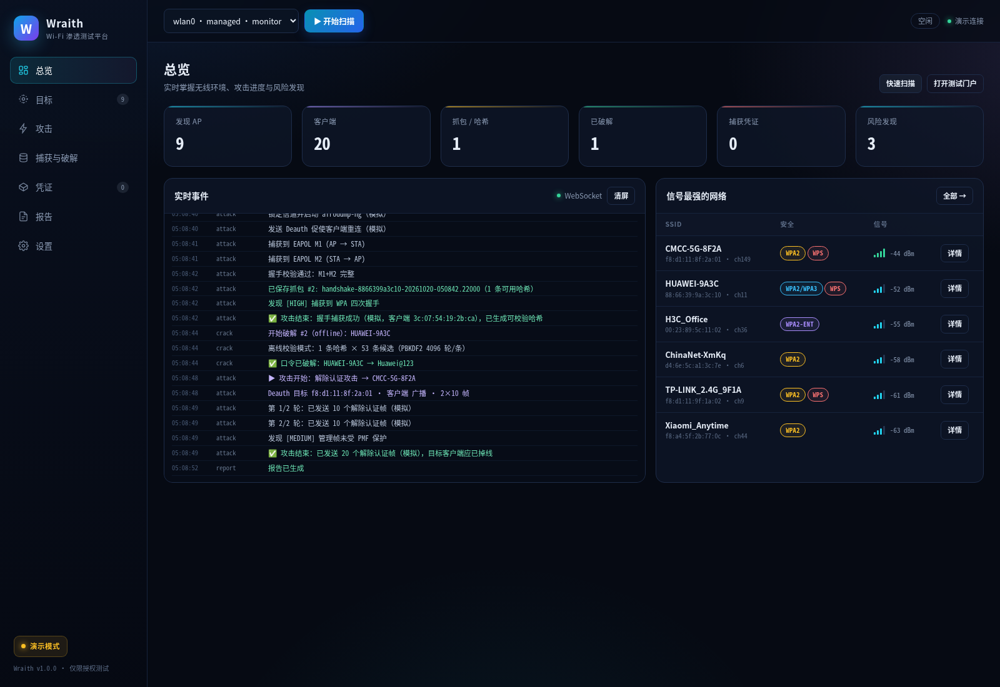
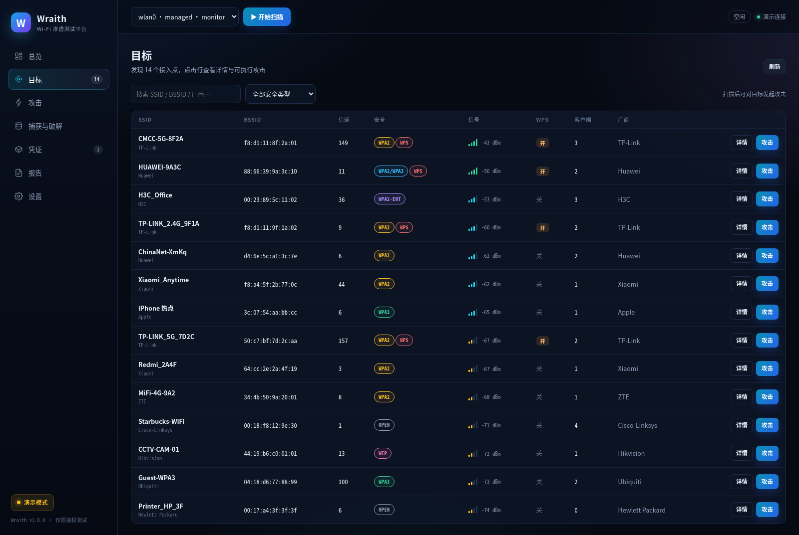
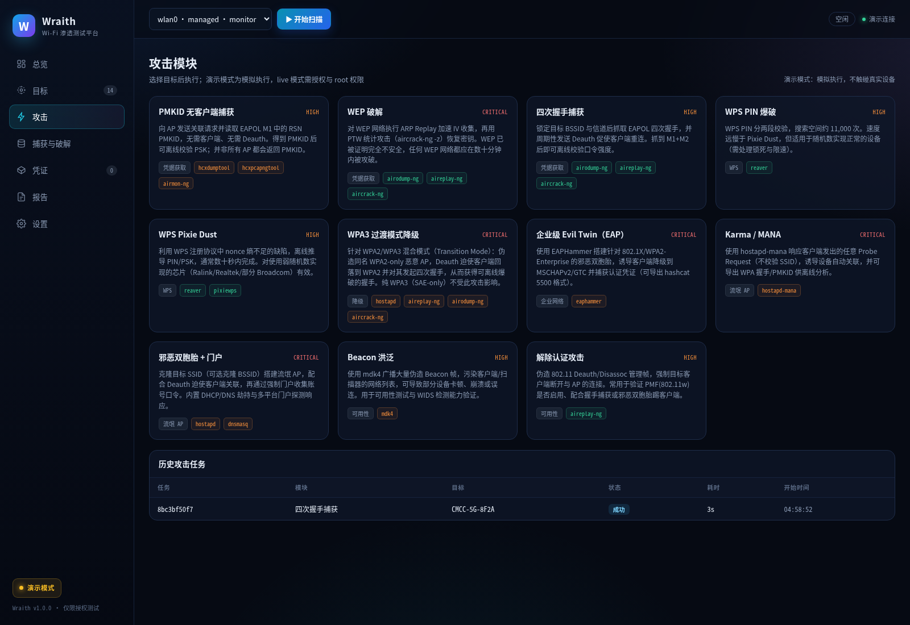
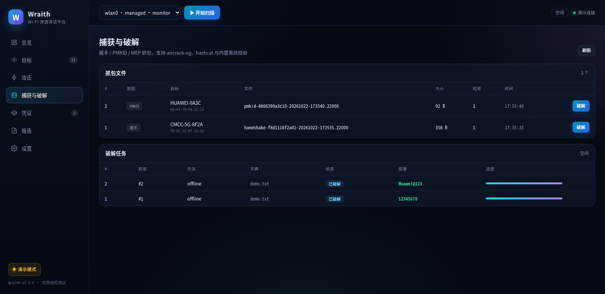
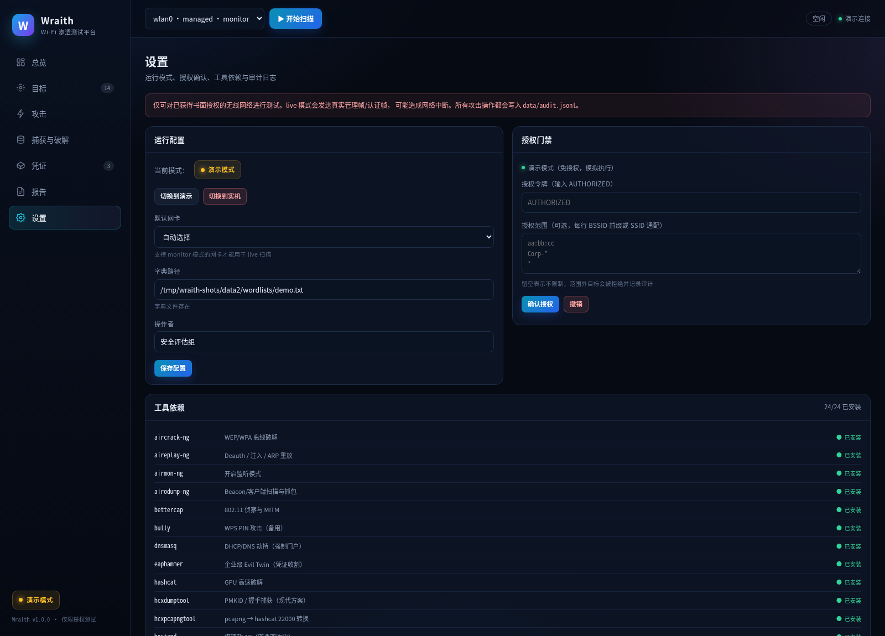
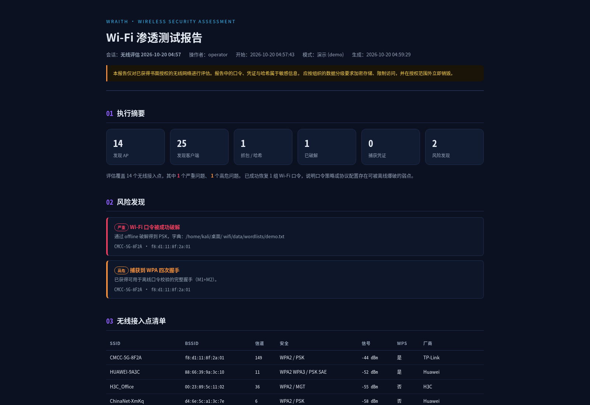

# Wraith · Wi-Fi 渗透测试平台

> **仅限获得明确书面授权的无线网络安全评估。**
> 未经授权对他人网络实施本平台中的任何操作，在绝大多数司法辖区均属违法行为。
> 使用者须自行承担全部法律责任。

Wraith 是一个面向 **802.11 安全评估** 的一体化平台：把散落在 aircrack-ng、hcxdumptool、
reaver、hostapd、mdk4、eaphammer 等工具链中的攻击手法，整合为可编排、可审计、
可出报告的 Web 控制台与 CLI。

- **11 个攻击模块**：Deauth、四次握手、PMKID、WPS Pixie/PIN、WEP、邪恶双胞胎+门户、
  WPA3 过渡模式降级、Karma/MANA、企业 EAP、Beacon 洪泛
- **完整闭环**：扫描 → 选目标 → 攻击 → 捕获 → 破解 → 报告
- **MCP 原生接入**：43 个功能点全部暴露为 MCP 工具，DSH / Claude / Codex 可通过
  stdio 或 Streamable HTTP 直接调用平台（见 [docs/MCP.md](docs/MCP.md)）
- **真实密码学**：PMKID / 四次握手校验用纯 Python 实现（带 hashcat 已知向量测试），
  演示模式生成的哈希与真实抓包一样可被 hashcat/aircrack 校验
- **强制授权门禁 + JSONL 审计日志**：live 模式必须显式确认授权，范围外目标一律拒绝；
  MCP 调用同样写审计，令牌等敏感参数自动脱敏
- **演示模式**：无需 root、无需无线网卡即可完整走通全流程（内置 14 个虚拟 AP）
- **中文界面 + 报告**：深色控制台、WebSocket 实时事件、HTML/JSON/Markdown 报告



---

## 目录

- [截图](#截图)
- [快速开始](#快速开始)
- [使用流程](#使用流程)
- [攻击模块](#攻击模块)
- [命令行](#命令行)
- [演示模式](#演示模式)
- [AI 代理 / MCP](#ai-代理--mcp)
- [架构](#架构)
- [API](#api)
- [数据与报告](#数据与报告)
- [测试](#测试)
- [硬件与系统要求](#硬件与系统要求)
- [安全与合规](#安全与合规)
- [已知限制](#已知限制)
- [参考](#参考)

---

## 截图

| 总览 | 目标 |
|---|---|
|  |  |

| 攻击模块 | 捕获与破解 |
|---|---|
|  |  |

| 设置与授权 | 报告 |
|---|---|
|  |  |

---

## 快速开始

### 1. 环境

- Linux（推荐 Kali / Debian 12+），Python **3.10+**
- 实机模式需要 root 与支持 **monitor + AP** 模式的无线网卡
- 演示模式无任何特殊要求

```bash
cd "wifi"
python3 -m venv .venv
source .venv/bin/activate
pip install -e .            # 或 pip install -r requirements.txt
```

系统工具（Kali 多数已预装）：

```bash
sudo apt update
sudo apt install -y aircrack-ng hcxdumptool hcxtools reaver bully pixiewps \
                    hostapd dnsmasq mdk4 macchanger iw \
                    hostapd-mana eaphammer bettercap kismet wifiphisher \
                    hashcat john tshark
./install.sh --tools        # 自动安装缺失的 apt 工具
python3 -m wraith doctor    # 检查依赖
```

需要跑测试时安装开发依赖：`pip install -e ".[dev]"`（pytest / pytest-asyncio / httpx）。

### 2. 演示模式（推荐先跑通）

```bash
python3 -m wraith web --demo --open
# → http://127.0.0.1:8787
# → API 文档 http://127.0.0.1:8787/docs
```

演示流程（约 30 秒）：

1. 右上角 **开始扫描**，等待发现 14 个虚拟 AP；
2. **目标** → 选择 `CMCC-5G-8F2A` → **攻击** → `四次握手捕获` → 启动；
3. **捕获与破解** → 对该抓包点 **破解**（方法选「内置离线校验」）→ 得到 `12345678`；
4. **报告** → **生成并保存**，查看 HTML 报告；
5. **凭证** → **打开测试门户**，在浏览器中体验强制门户提交与实时捕获。

> 演示模式不发送任何无线帧；但生成的 PMKID/MIC 是**真实可校验**的哈希，
> 可用 `hashcat -m 22000` 复核。

### 3. 实机模式

```bash
# 建议使用 venv 里的 python，并保留环境变量
sudo -E .venv/bin/python -m wraith web --live --open --iface wlan0
```

进入 **设置**：

1. 在「授权门禁」输入 `AUTHORIZED`，填写操作者与授权范围（可选）；
2. 目标不在范围内会被直接拒绝并写入 `data/audit.jsonl`；
3. 返回 **总览** 开始扫描。

> 实机模式会真实发送 Deauth/Beacon/认证帧，可能造成网络中断。请只在隔离环境或
> 明确授权的生产窗口内使用。

---

## 使用流程

```
┌────────────┐   ┌────────────┐   ┌────────────┐   ┌────────────┐   ┌────────────┐
│  侦察扫描   │ → │  选择目标   │ → │  执行攻击   │ → │  捕获破解   │ → │  生成报告   │
│ airodump-ng│   │ AP/客户端   │   │ 11 个模块   │   │ cap/22000  │   │ HTML/JSON  │
└────────────┘   └────────────┘   └────────────┘   └────────────┘   └────────────┘
```

**扫描**：`airodump-ng` 输出 CSV 增量解析，实时入库；自动识别 WPA2/WPA3 过渡模式、
企业级 AKM、WPS 状态（`wash`），并记录客户端 PNL 探测列表。

**选目标**：表格支持按 SSID/BSSID/厂商/安全类型筛选；行内抽屉展示客户端、
关联风险与可执行模块。

**攻击**：模块卡片式选择，自动填充目标 BSSID/SSID/信道/加密；实时日志经 WebSocket 推送；
一次仅允许一个攻击任务，避免无线资源冲突。

**破解**：抓包自动识别格式并选择 `aircrack-ng` / `hashcat (-m 22000)` / 内置离线校验；
结果回写抓包、生成 critical 级发现。

**报告**：一键生成自包含 HTML（可打印）、JSON（可二次分析）、Markdown（可入库）。

---

## 攻击模块

| ID | 名称 | 依赖 | 风险 | 说明 |
|---|---|---|---|---|
| `deauth` | 解除认证攻击 | aireplay-ng | 高 | 定向/广播 Deauth，验证 PMF 是否启用 |
| `handshake` | 四次握手捕获 | airodump-ng, aireplay-ng | 高 | 锁信道抓 EAPOL，周期 Deauth 触发重连 |
| `pmkid` | PMKID 无客户端捕获 | hcxdumptool, hcxtools | 高 | 单帧获取 PMKID，无需客户端 |
| `wps_pixie` | WPS Pixie Dust | reaver, pixiewps | 高 | 离线推导 PIN/PSK，通常数十秒 |
| `wps_pin` | WPS PIN 爆破 | reaver | 高 | 约 11,000 次在线尝试 |
| `wep` | WEP 破解 | airodump/aireplay/aircrack | 严重 | ARP Replay + PTW |
| `evil_twin` | 邪恶双胞胎 + 门户 | hostapd, dnsmasq | 严重 | 克隆 SSID/BSSID，DHCP/DNS 劫持，凭证收割 |
| `wpa3_downgrade` | WPA3 过渡模式降级 | hostapd, aireplay, airodump | 严重 | 伪造 WPA2 twin，诱导客户端回落 |
| `karma` | Karma / MANA | hostapd-mana | 严重 | 响应任意 Probe Request |
| `enterprise` | 企业级 Evil Twin | eaphammer | 严重 | EAP 降级、MSCHAPv2 捕获 |
| `beacon_flood` | Beacon 洪泛 | mdk4 | 高 | 伪造海量 SSID，可用性测试 |

每个模块在 **演示模式** 下都能运行（模拟执行），其中握手/PMKID 会生成可真实校验的哈希。

> 纯 WPA3（SAE-only）无法离线爆破；平台会明确拒绝不适用的模块并说明原因，
> 不会伪造“成功”。

详细手法、原理与工具生态见 **[docs/ATTACK_TECHNIQUES.md](docs/ATTACK_TECHNIQUES.md)**。

---

## 命令行

```bash
wraith doctor                          # 依赖体检
wraith interfaces                      # 网卡与 monitor/AP 能力
wraith web --demo                      # Web 控制台（含 /mcp）
wraith mcp --demo                      # stdio MCP 服务器（供 DSH 拉起）
wraith mcp --transport http -p 8790    # 独立 MCP HTTP 服务
wraith mcp --url http://127.0.0.1:8787 # 代理到已运行的控制台
wraith scan -i wlan0 -t 60             # 命令行扫描 60 秒
wraith targets                         # 最近一次有结果的会话
wraith attack handshake -b <BSSID> -e <SSID> -c 6 --security WPA2
wraith attack evil_twin -b <BSSID> -e <SSID> -c 6 -o timeout=300
wraith crack 3 --method offline        # 破解抓包 #3
wraith report -f html -o report.html   # 导出报告
```

全局开关需放在子命令前，例如：

```bash
sudo wraith --live --authorized scan -i wlan0 -t 120
sudo wraith --live --authorized attack pmkid -b AA:BB:CC:DD:EE:FF
```

---

## 演示模式

演示模式是**完整的攻击链路模拟器**，用于培训、验收与无硬件开发：

- 14 个虚拟 AP（CMCC / Huawei / TP-Link / H3C / 摄像头 / 打印机 / iPhone 热点…），
  覆盖 OPEN / WEP / WPA2 / WPA2-WPA3 过渡 / WPA3 / WPA2-ENT
- 客户端、信号抖动、Beacon 计数与 PNL 探测均为动态生成
- 握手捕获生成 **22000 type-02（EAPOL MIC）**，PMKID 生成 **type-01**
- 内置字典 `data/wordlists/demo.txt` 含演示口令，破解是真实 PBKDF2 校验
- 强制门户是**真实 HTTP 服务**（127.0.0.1 随机端口），可手动提交并实时落库

演示模式的输出会标注 `demo: true`，报告中的模式字段也会明确写「演示 (demo)」。

---

## AI 代理 / MCP

Wraith 内置 MCP 服务器，把 **43 个功能点**（系统/授权/扫描/AP/客户端/攻击/抓包/
破解/凭证/发现/事件/会话/门户/报告）全部暴露为 AI 可调用工具。工具不复制业务逻辑，
而是复用同一套 REST 路径，因此授权门禁、demo/live 行为与 Web 控制台完全一致。

```bash
# stdio：供 DSH / Claude Desktop 直接拉起（默认 demo）
./scripts/mcp-stdio.sh --demo

# Streamable HTTP：随 Web 控制台挂载
.venv/bin/python -m wraith web --demo
# → http://127.0.0.1:8787/mcp
```

DSH 配置文件（`~/.dsh/profiles/<profile>/cordis.patch.yml`）：

```yaml
- id: mcp-wraith
  name: '@deepseek-ai/dsh-mcp-client'
  config:
    serverName: wraith
    transport: stdio
    command: /home/kali/桌面/ wifi/scripts/mcp-stdio.sh
    args: ['--demo']
    cwd: /home/kali/桌面/ wifi
    toolCallTimeoutMs: 120000
```

重载后工具以 `mcp__wraith__scan_start`、`mcp__wraith__attack_start` 等形式出现。
推荐链路：`system_info → scan_start → aps → attack_start → attack_wait → captures →
crack_start → crack_wait → report`。

live 模式必须先在工具中 `authorize(token="AUTHORIZED")`；每次调用写入
`data/mcp-audit.jsonl`，令牌/口令等参数自动脱敏。完整工具清单、客户端配置与
故障排查见 **[docs/MCP.md](docs/MCP.md)**。

---

## 架构

```
wraith/
├── cli.py                 # argparse CLI（web/mcp/scan/attack/crack/report/doctor）
├── config.py              # 配置：文件 + WRAITH_* 环境变量
├── models.py              # AP/Client/Capture/CrackJob/Credential/Finding/Session
├── store.py               # SQLite（WAL）+ 线程安全 CRUD
├── events.py              # 进程内事件总线（WebSocket 扇出 + 历史回放）
├── authorization.py       # 授权门禁 + JSONL 审计
├── mcp/
│   ├── specs.py           # 43 个工具声明（JSON Schema + REST 映射）
│   ├── runtime.py         # 参数校验、ASGI/HTTP 调用、等待/下载组合工具、审计
│   ├── protocol.py        # MCP JSON-RPC（initialize/tools/list/tools/call）
│   ├── stdio.py           # stdio 传输 + 嵌入式惰性启动
│   └── http.py            # Streamable HTTP /mcp + Origin 校验
├── system/
│   ├── deps.py            # 工具依赖矩阵与安装建议
│   ├── runner.py          # 无 shell 的异步命令执行（脱敏/超时/只读探测）
│   └── iface.py           # 网卡枚举、monitor/AP 模式、信道
├── recon/
│   ├── scanner.py         # airodump-ng CSV 解析 + 演示扫描器
│   └── demo.py            # 虚拟无线环境与真实演示哈希种子
├── attacks/
│   ├── base.py            # AttackModule / AttackContext / AttackResult
│   ├── manager.py         # 任务编排（单任务、授权、preflight、日志）
│   ├── portal.py          # 纯 asyncio 强制门户（多平台探测劫持）
│   └── *.py               # 11 个攻击模块
├── crack/
│   ├── offline.py         # PMKID/MIC 纯 Python 校验（hashcat 向量测试）
│   ├── tools.py           # aircrack-ng / hashcat / hcxtools / reaver 封装
│   └── manager.py         # 破解任务、进度、结果回写
├── report/generator.py    # HTML / Markdown / JSON 报告
└── web/
    ├── app.py             # FastAPI：REST + WebSocket + /mcp + 静态控制台
    ├── state.py           # 生命周期与子系统装配
    └── static/            # 控制台（原生 JS，无构建步骤）
```

**安全设计**：

- 命令一律以 `argv` 列表执行，`shell=False`，避免注入；
- 口令类参数写日志前脱敏（`redact_command`）；
- 抓包下载校验路径必须位于 `captures/` 内；
- 所有攻击入口同时经过 **API 授权检查 + 模块内 `ctx.authorize` 审计**；
- MCP 工具复用同一 REST 路径，不绕过授权；`/mcp` 校验 Origin，调用写
  `data/mcp-audit.jsonl` 并脱敏令牌/口令；
- 关闭服务时终止子进程、结束会话、释放监听网卡。

---

## API

交互式文档：`http://127.0.0.1:8787/docs`

| 方法 | 路径 | 说明 |
|---|---|---|
| GET | `/api/system` | 模式、会话、网卡、依赖、授权状态 |
| POST | `/api/system/mode` | 切换 demo/live |
| POST | `/api/system/config` | 更新网卡/字典/操作者 |
| POST | `/api/authorization` | 授权（令牌 `AUTHORIZED`） |
| GET | `/api/scanner` | 扫描状态与快照 |
| POST | `/api/scan/start` / `stop` | 开始/停止扫描 |
| GET | `/api/aps` / `/{bssid}` | 目标列表 / 详情 |
| GET | `/api/attacks` | 模块列表、活动任务 |
| POST | `/api/attacks/{id}/start` | 启动攻击 |
| POST | `/api/attacks/stop` | 停止当前攻击 |
| GET | `/api/attacks/jobs` / `/{job_id}` | 攻击历史 / 任务详情 |
| GET | `/api/captures` | 抓包列表（可下载） |
| POST | `/api/captures/{id}/crack` | 启动破解 |
| GET | `/api/cracks` / `/{job_id}` | 破解列表 / 任务详情 |
| GET | `/api/credentials` | 门户凭证 |
| GET | `/api/report/html\|json\|md` | 在线报告 |
| POST | `/api/report/save` | 保存三种格式 |
| POST | `/mcp` | MCP Streamable HTTP（JSON-RPC） |
| WS | `/ws` | 实时事件流 |

---

## 数据与报告

| 路径 | 内容 |
|---|---|
| `data/wraith.db` | 会话、AP、客户端、抓包、破解、凭证、发现、事件 |
| `data/audit.jsonl` | 授权决策审计（允许/拒绝、目标、操作者） |
| `data/mcp-audit.jsonl` | MCP 工具调用审计（参数脱敏） |
| `data/commands.jsonl` | 实际执行的命令（参数脱敏） |
| `captures/` | `.cap` / `.pcapng` / `.22000` 抓包 |
| `data/reports/` | 生成的 HTML/JSON/Markdown 报告 |
| `data/run/` | hostapd/dnsmasq 临时配置与 mana 输出 |

报告包含：执行摘要、按严重度排序的风险发现、AP 清单、已恢复口令、门户凭证、
抓包与破解记录、事件时间线、修复建议。

---

## 测试

```bash
python3 -m pytest -q
# 79 passed
```

覆盖：

- **密码学**：hashcat 官方 PMKID 向量、EAPOL MIC 往返校验、gzip 字典、22000 解析
- **协议归一化**：安全类型/频段/信号/OUI
- **解析器**：airodump CSV（含握手标记、截断行）
- **存储**：upsert 语义、事件过滤、统计
- **攻击**：模块注册、参数校验、演示模式握手→破解闭环
- **门户**：HTTP 服务、`generate_204` 劫持、表单捕获、303 跳转
- **授权**：demo/live 分支、令牌、范围通配、审计落盘
- **报告**：三种格式与内容断言
- **API**：扫描 → 攻击 → 破解 → 报告全链路、WebSocket、live 拒绝
- **MCP**：initialize/tools 协议、43 工具与 REST 路由一一覆盖、demo 全链路、
  live 授权拒绝、审计脱敏、stdio 子进程握手

---

## 硬件与系统要求

| 场景 | 要求 |
|---|---|
| 演示模式 | 任意 Linux + Python 3.10+ |
| 被动扫描 | 支持 monitor 的网卡 + root |
| Deauth / 握手 / PMKID / WPS / WEP | monitor 网卡 + root |
| 邪恶双胞胎 / Karma / 企业 EAP | 支持 AP 模式 + 第二块 monitor 网卡（用于 Deauth 助攻） |
| 5GHz / 6GHz | 对应频段网卡（如 MT7921、AX200、RTL8812AU） |

虚拟机使用 USB 无线网卡需在宿主机把设备直通给虚拟机。`iw dev` 中
`type monitor` 能力是硬性前提。

---

## 安全与合规

- 平台内置**代码级授权门禁**：live 模式未授权时，所有攻击入口返回 403 并审计；
- 支持授权范围（BSSID 前缀 / SSID glob），范围外目标一律拒绝；
- 每次允许/拒绝都写入 `data/audit.jsonl`，包含操作者、动作、目标、原因；
- 门户默认模板为通用认证页，**不包含任何品牌素材**，不做同形字仿冒；
- 平台不内置会破坏生产网络的武器化载荷（如 SAE 溢出、固件漏洞利用），
  相关研究能力仅以检测/验证形式存在。

法律提示：中国《网络安全法》第 27 条、《刑法》第 285/286 条；美国 CFAA；
欧盟 NIS2 及各成员国刑法。**获得书面授权、约定测试窗口与范围，是唯一合法的使用前提。**

---

## 已知限制

1. **实机路径已在本机冒烟验证**：11 个模块在 demo 模式全绿；live 模式在授权测试 AP
   （`SZ078837`）上逐模块跑通。`hcxdumptool` 6.x/7.x 的参数差异已自动适配
   （`--enable_status` → `--rds`，7.x 的信道需带频段后缀）。
2. **连续攻击之间 `airmon-ng` 改名存在竞态**：上一次收尾时网卡可能短暂消失/残留
   `wlan0mon`，`IfaceManager` 已加重试、重新解析与残留 vif 清理，不同驱动仍建议实测。
3. **客户端不校验证书**是企业 EAP 攻击的前提，实际成功率取决于终端配置。
4. **PMKID 并非所有 AP 都返回**；纯 WPA3 不支持离线爆破。
5. `airodump-ng` CSV 对含逗号的 SSID 无引号转义，解析器按列数容错。
6. 强制门户对 IPv6 直连、DoH、已有 VPN 的客户端可能无效，生产评估需配合 DNS/DNAT 策略。
7. 单网卡无法同时做 AP 与 monitor；邪恶双胞胎的 Deauth 助攻需要第二块网卡。

---

## 参考

- [docs/ATTACK_TECHNIQUES.md](docs/ATTACK_TECHNIQUES.md) — 攻击手法总览（含 GitHub 生态矩阵）
- [docs/MCP.md](docs/MCP.md) — MCP 接入指南（43 工具、DSH/Claude 配置、审计与排查）
- [Model Context Protocol](https://modelcontextprotocol.io) — MCP 规范与客户端生态
- [aircrack-ng](https://github.com/aircrack-ng/aircrack-ng) · [hcxdumptool](https://github.com/ZerBea/hcxdumptool) · [hcxtools](https://github.com/ZerBea/hcxtools)
- [wifite2](https://github.com/derv82/wifite2) · [airgeddon](https://github.com/v1s1t0r1sh3r3/airgeddon) · [wifiphisher](https://github.com/wifiphisher/wifiphisher) · [wifipumpkin3](https://github.com/P0cL4bs/wifipumpkin3)
- [eaphammer](https://github.com/s0lst1c3/eaphammer) · [hostapd-mana](https://github.com/sensepost/hostapd-mana)
- [KRACK](https://www.krackattacks.com) · [Dragonblood](https://wpa3.mathyvanhoef.com) · [FragAttacks](https://www.fragattacks.com)
- IEEE 802.11-2020 / 802.11ax / 802.11be；Wi-Fi Alliance WPA3 Specification

---

## License

MIT（见 [LICENSE](LICENSE)）。软件按“现状”提供，作者不对使用后果承担责任。
